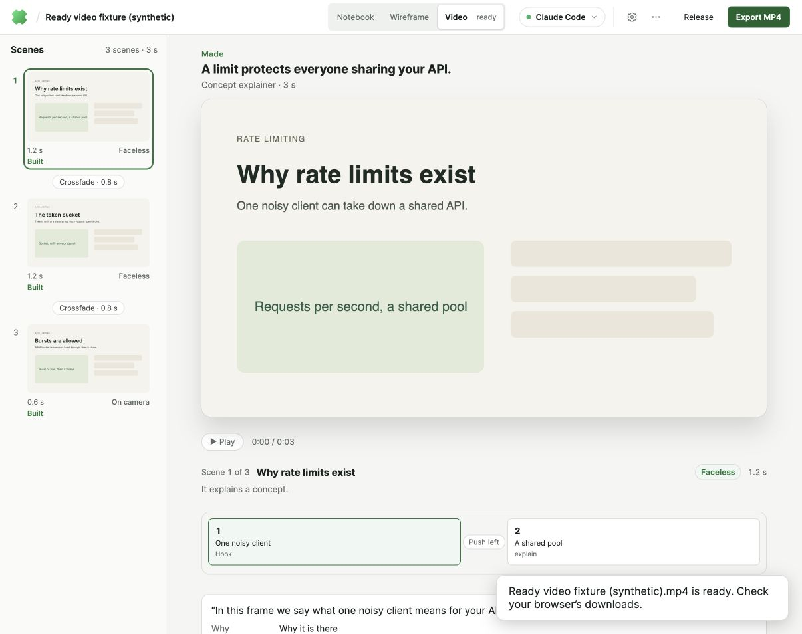
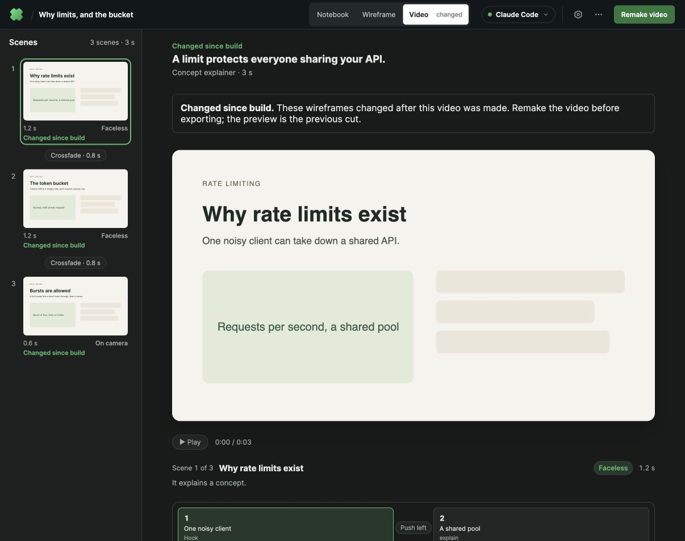

# PR #19 UX review fixes — 17 October 2026

Validated against PR head `1e217bc9ffea4ddb28520994156961968557a2c2`.
The supplied UX review contains six bugs and five UX findings. All eleven are
addressed below; U1 was already fixed upstream and now has regression coverage.

| Finding | Resolution | Visible browser evidence |
| --- | --- | --- |
| B1 | Enter inserts a newline; Cmd/Ctrl+Enter or the button submits. Preserve the entire draft across renders/failures and prevent overlapping submissions. The reproduced trigger was Enter, rather than the input listener. | [Full multiline draft](2026-10-17-pr19-ux-fixes/01-multiline-before-submit.jpg), [saved once](2026-10-17-pr19-ux-fixes/02-full-notes-saved.jpg) |
| B2 | Source changes mark storyboard video stale, label affected UI, block download/release/publish, and offer a confirmed remake retaining takes. Existing scene fingerprint checks remain. | [Stale export blocked](2026-10-17-pr19-ux-fixes/08-stale-video-blocked.jpg), [remake confirmation](2026-10-17-pr19-ux-fixes/09-remake-confirmation.jpg) |
| B3 | One request per export, busy button, accessible progress/success/error notice, and title-based filenames. | [MP4](2026-10-17-pr19-ux-fixes/13-light-theme-export.jpg), [PDF](2026-10-17-pr19-ux-fixes/12-pdf-export-feedback.jpg) |
| B4 | Show an available poster or wireframe fallback and use the shared custom playback controls. | [Desktop player](2026-10-17-pr19-ux-fixes/13-light-theme-export.jpg), [390px mobile](2026-10-17-pr19-ux-fixes/10-mobile-video.jpg) |
| B5 | Declare the existing SVG logo as favicon; verified HTTP 200. | Production build resolves the icon asset. |
| B6 | Add reversible Archive and Restore actions for standalone notebook cards. | [Archived notebook and Restore](2026-10-17-pr19-ux-fixes/03-archive-with-restore.jpg) |
| U1 | Confirm empty submission is disabled; add regression test. | Automated DOM assertion. |
| U2 | Series titles navigate to their content map or a reloadable dedicated series page; explicit episode buttons and primary Save threads action. | [Map navigation](2026-10-17-pr19-ux-fixes/04-series-title-opens-map.jpg), [standalone page after save/reload](2026-10-17-pr19-ux-fixes/11-standalone-series-page.jpg) |
| U3 | Use Share your video, labeled release date/time, Social posts and Performance; emphasize actions. | [Release dialog](2026-10-17-pr19-ux-fixes/07-release-dialog.jpg) |
| U4 | Prefix episode template names with Template and explicitly label episode navigation. | [Series page](2026-10-17-pr19-ux-fixes/11-standalone-series-page.jpg) |
| U5 | Keep a single Cancel in forms or a named top close button in passive dialogs. | [Release](2026-10-17-pr19-ux-fixes/07-release-dialog.jpg), [confirmation](2026-10-17-pr19-ux-fixes/09-remake-confirmation.jpg) |

## Validation

- TypeScript check and full Vitest suite: **187 files, 1,167 tests passed**.
- Production Vite build passed (existing large-chunk advisory).
- Prettier and source-size checks passed.
- Disposable PostgreSQL/MinIO storage checks passed, including restart recovery,
  remote media, PDF, takes, and corruption rejection.
- Visible in-app browser on frontend **4289**, backend **4389**, using an isolated
  temporary data directory. Port 4187 and real notebook data were not used.
- Clicked multiline create, archive/restore, series/map navigation, Save threads,
  episode navigation, playback, PDF/MP4 export, release and remake confirmation.
  Verified stale MP4 download returns HTTP 409. Cancelled the remake confirmation.
- Checked light and dark themes and 390px mobile; mobile document width matched
  viewport width with no horizontal overflow.

Screenshots use synthetic notebooks and a generated test-pattern clip. They prove
UI behavior and export machinery, **not model output**. Paid AI generation and a
live social publish were not exercised. Credentials were not needed.

