# Projects and branching research

Implemented on `codex/projects-research`, based on PR 19 head `5a5954d`.

## Experience

The landing page accepts a first note without setup and creates a project with one notebook. A project contains separately named notebooks. Saved notes are durable before any AI operation. The research view combines a navigable question graph, a conversation, and a notebook capture panel. Selecting a response passage offers Save to notebook or Ask about this. Saved excerpts retain the exact source response, question, offsets, and repository commit context. View source returns to the original question. Asking about a captured excerpt branches from its source response.

Research supports the existing Claude Code, Codex, and Kimi adapters. Up to four local repository/branch pairs can be selected. Each question pins branch heads to commits and exposes read/search/diff tools at those revisions. Follow-ups receive their selected ancestors, not unrelated sibling conversations. The project notebooks are also supplied as research context.

Wireframes appear in a continuous view grouped by notebook, with a jump selector. One aggregate notebook powers the project's shared content map and existing series workflow. Subsequent notes feed that map through the durable queue, with deterministic IDs to prevent duplicate synchronization. Existing notebooks remain accessible through Earlier notebooks & studio tools.

## Validation

Visible browser tests use the isolated stack at http://127.0.0.1:4291 (engine 4391) and disposable data at `/private/tmp/incredible-projects-research`. Existing stacks were left untouched.

- Created and renamed a project; added a second notebook and notes.
- Linked two local repositories with branch choices; completed a real Claude Code answer citing both repositories.
- Selected and saved a response excerpt, followed it into a new question, and completed a real answer.
- Returned to the original question and completed a sibling branch; all paths remain visible.
- Confirmed exact excerpt text after fixing a template-whitespace offset error.
- Cancelled a real question; the stopped node and earlier answers remain after reload.
- Confirmed an unsent question survives reload.
- Checked the research layout at desktop and 390px mobile widths.
- Generated real notebook and aggregate canvas wireframes; opened the interactive shared map and verified that a subsequently captured excerpt was queued there with its notebook label.
- Started generation for the second notebook and verified the continuous view and notebook jump selector. Screenshot captures show incremental generation, not a claim that all drawing jobs had finished.
- Full suite: 228 files / 1,494 tests passed, including the stopped-state recovery regression test.
- Production build and source-size checks passed. Existing disposable PostgreSQL/S3 storage check passed.

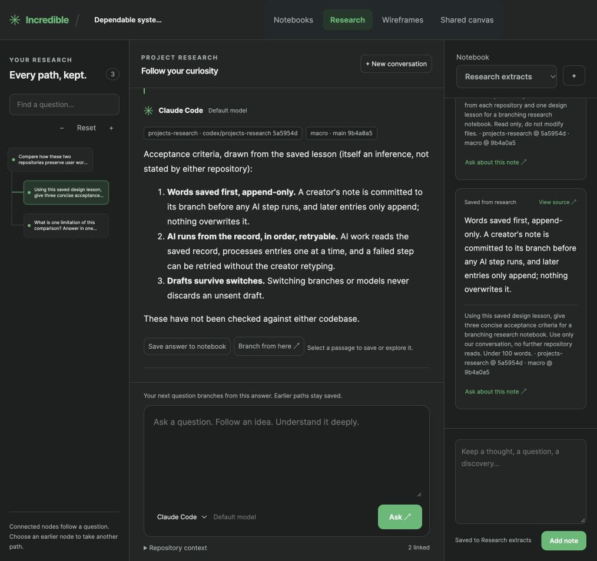

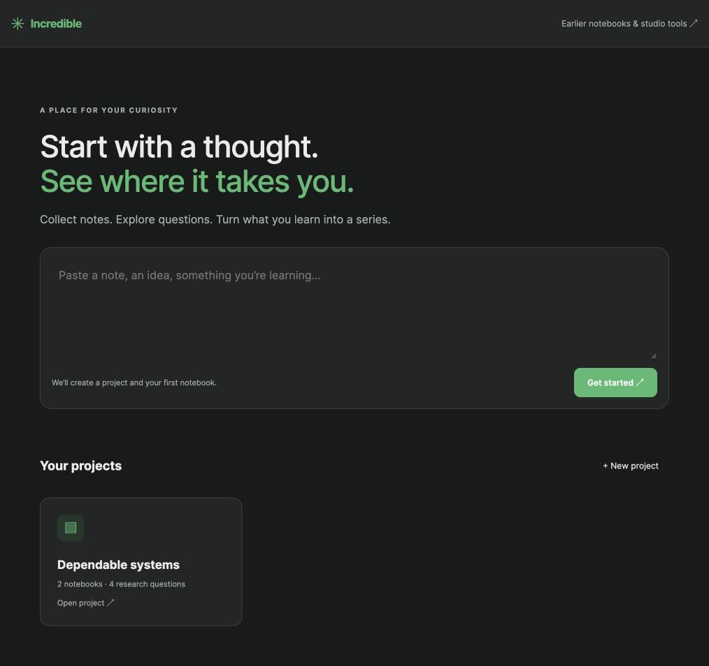

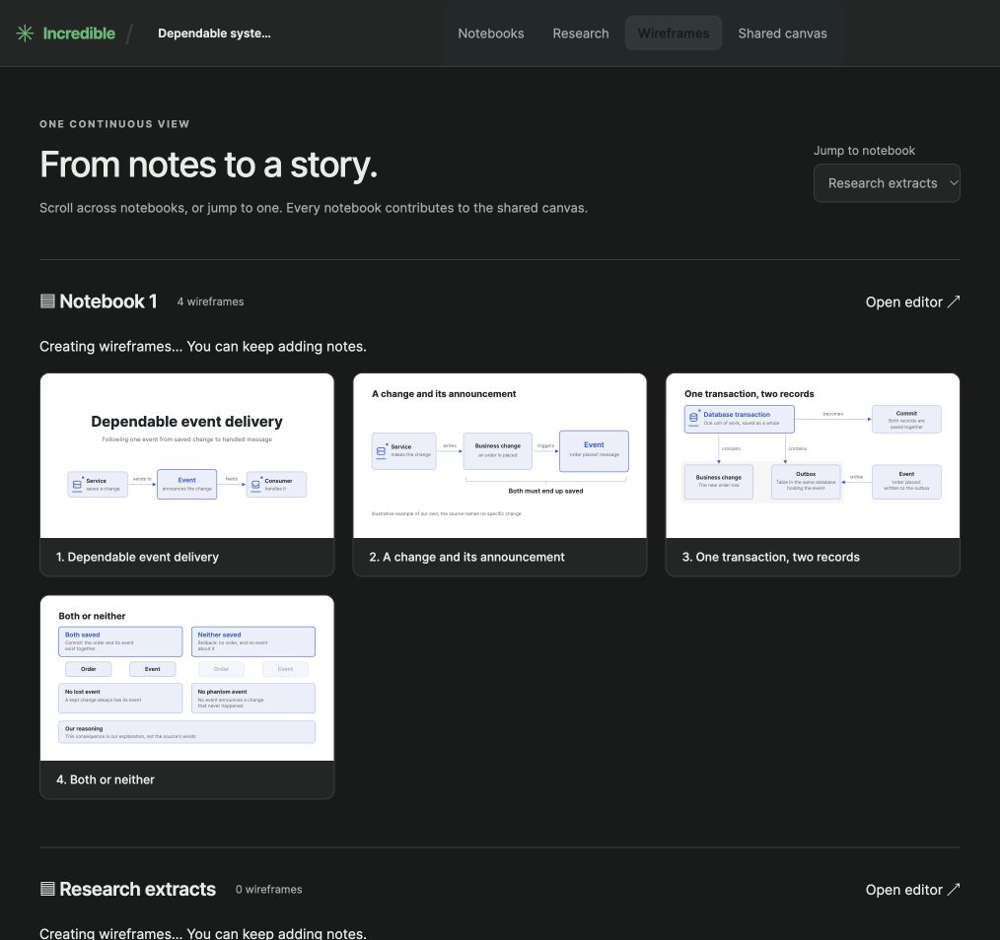

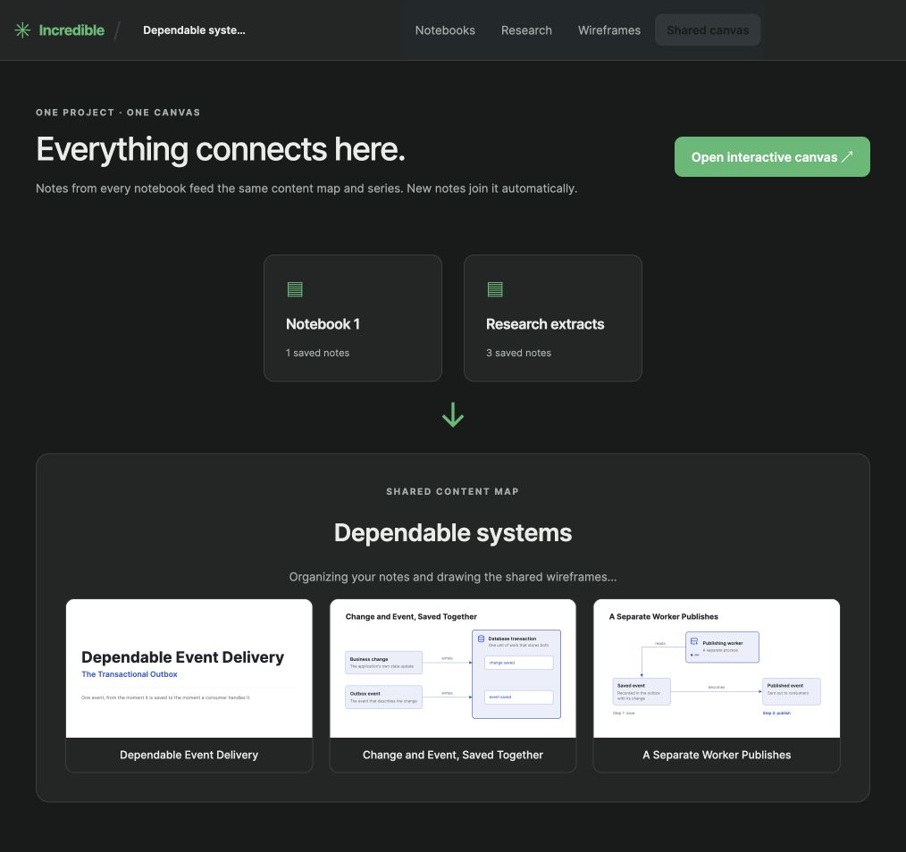

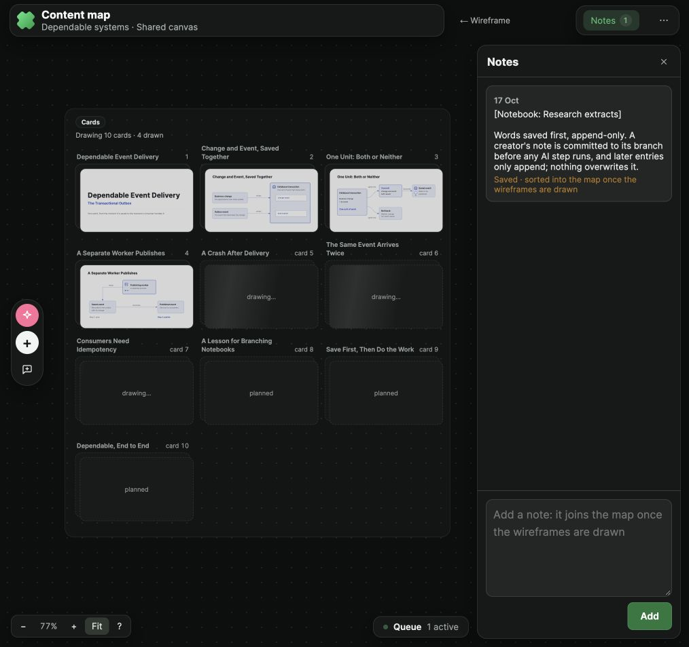

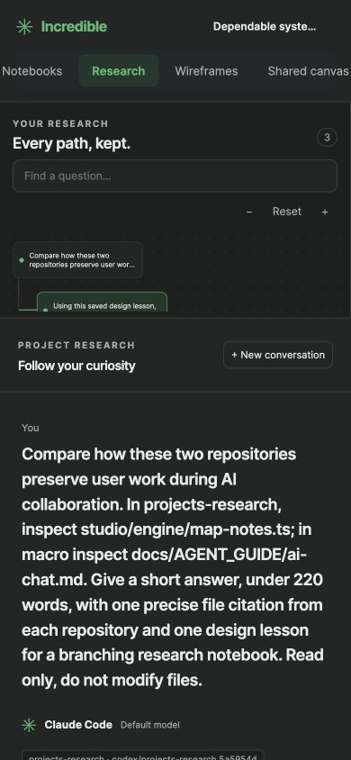

## Current boundaries

Research reports progress and then renders the validated final answer; it does not stream response tokens. Saved note blocks are append-only to retain provenance. Existing standalone notebooks are not automatically migrated into projects. The initial project validation exercised Claude Code live. The named-chat validation below additionally exercises Kimi and records a Codex runtime failure. Repository context reads committed revisions, not uncommitted working-tree changes.

## Named chats and human–AI collaboration

Each project now has saved, named chats with independent repository/branch context and agent/model defaults. New chat creates a durable session before its first question. The first question in a new project can still create its chat automatically. Existing research roots become stable chat records on read; subsequent normal saves persist that upgrade without changing notes or answer provenance.

The implementation adapts Macro's session identity, context controls, and stable workspace panes (local references: `docs/AGENT_GUIDE/ai-chat.md` and `apps/web/src/lib/split-router/README.md` in the sibling Macro repository). The creator directs research, chooses the next agent, selects evidence to keep, and moves the resulting project knowledge into content production. Agent selection can change within a chat. Every answer retains the agent and exact repository commits that produced it.

- Chat URLs, independent drafts, current branch positions, repository choices and agent defaults survive the relevant navigation paths. Reload restores the URL's chat/question and saved configuration; unsent drafts persist in session storage.
- Backtracking does not replace the chat's next-answer agent with the historical answer's agent. Cross-chat parent injection is rejected.
- Separate chats can run independently; a chat allows one live answer at a time. Stop and retry retain earlier answers.
- Repository controls open above the composer and preserve its draft. Up to four repository/branch pairs are supported.
- The workspace explicitly connects Research → Keep notes → Create a series. Saved excerpts scroll into view and retain their source link.
- Mobile prioritizes chat, with an expandable graph. The 390px layout has no horizontal overflow.

### Live browser evidence

Testing used the visible parallel stack on 4291/4391 and disposable project data, with no changes to the stack on 4187.

1. Created **From research to a YouTube series** and linked Macro's `main` branch plus this worktree's `codex/projects-research` branch. Claude Code completed a real comparison with citations from both repositories.
2. Selected Codex for a follow-up within the same chat. Its CLI exited with code 1 before producing events. The failed turn remained in the graph. **Ask again** with Claude Code recovered the question and produced the series outline. This is not evidence of successful live Codex generation.
3. Created **Episode framing** with Kimi and no repositories. Confirmed that its independent draft and agent choice survived chat switching and reload. Kimi completed a real answer using the shared project notes.
4. Switched that same chat to Claude Code and completed a follow-up using Kimi's answer. Saved the resulting viewer promise into **Series outline** and verified **View source** returns to its chat and question.
5. Saved the repository-based outline into a new notebook, verified both notebooks remain available and the shared canvas includes the new notebook, and started real wireframe generation from the saved outline. Generation completed with ten real wireframes, including the chat/notebook comparison, excerpt-origin fields, and an episode-planning example. No new finished video or YouTube upload is claimed.
6. Rechecked desktop and mobile layouts, agent-name legibility, repository controls, and the saved-note handoff.

Final checks: 230 test files / 1,504 tests passed. After the final composer/layout adjustments, the 19 focused research tests, TypeScript, production build, formatting and source-size checks passed. Disposable PostgreSQL/S3 storage checks passed. Sandbox-only failures to start local fixture servers, browsers, and Docker were resolved by running those checks with the required local process access.

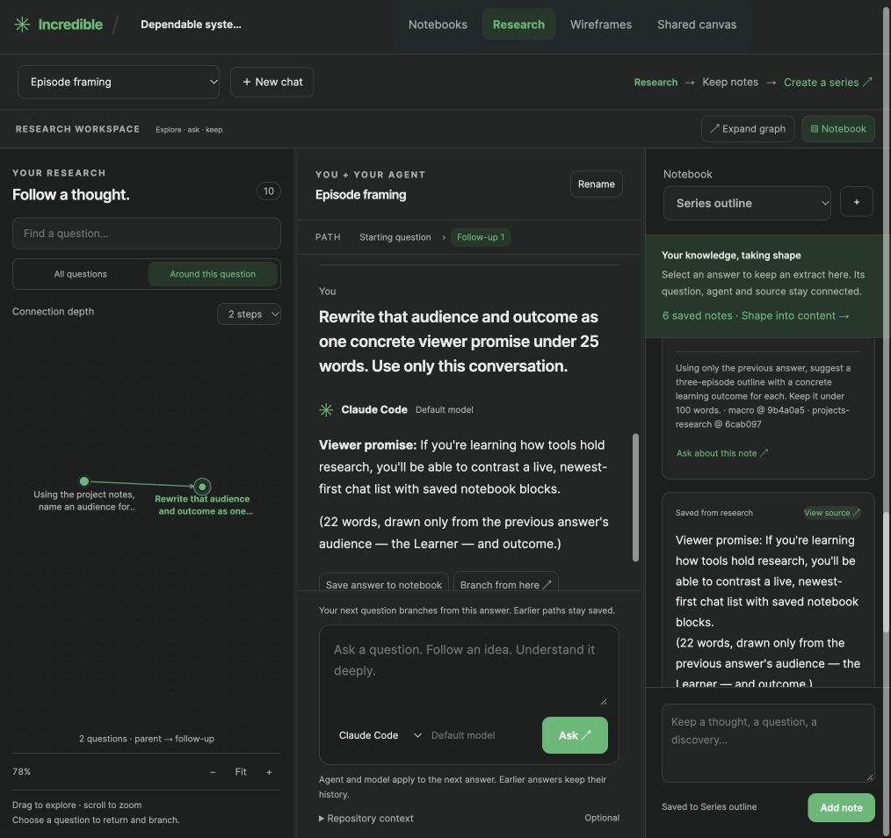

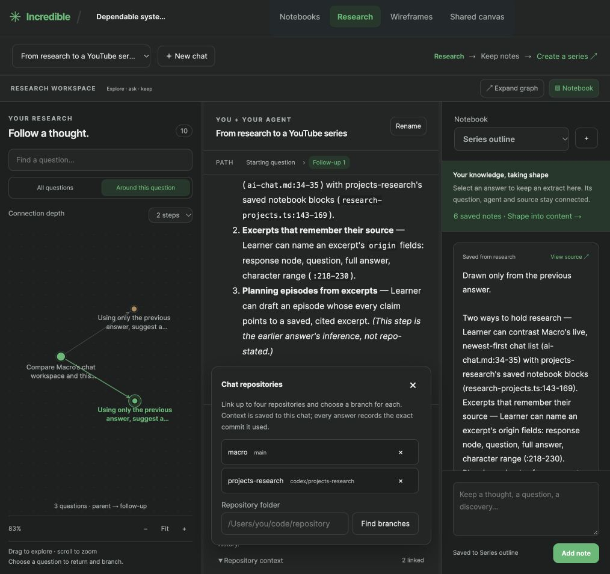

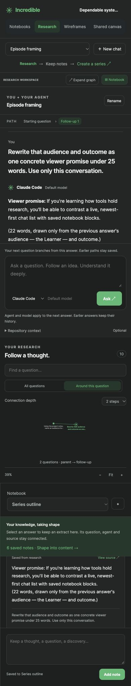

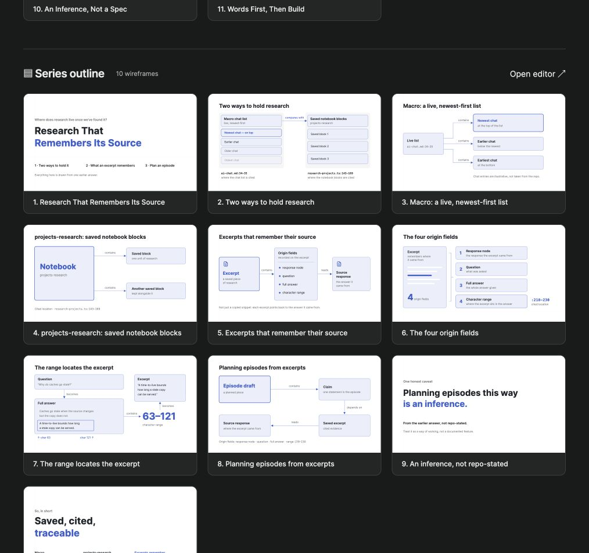

## Explicit Kimi K3 validation

The visible parallel stack on 4291/4391 was configured to use Kimi with the explicit model ID `kimi-code/k3`. The research chat and a new **Kimi K3 validation** notebook both persist that selection; the new-notebook default was saved through Settings → Agent & model. Existing historical answers retain their original agents.

- K3 read `studio/engine/research-sessions.ts` in this worktree and `docs/AGENT_GUIDE/ai-chat.md` in Macro through the repository tools. The real research run completed successfully in approximately 89 seconds, with no harness failure.
- The answer cited both repositories and distinguished implemented behavior from a proposed improvement. Its cited claims were checked against the local source files.
- **Save answer to notebook** retained the answer and its origin, including the source question and pinned revisions (`df72afc` and `9b4a0a5`). **View source** returned to the correct K3 question.
- Started real wireframe generation from this saved K3 answer. The target notebook persists `{ adapter: "kimi", model: "kimi-code/k3", label: "K3" }`. Engine records confirm both the requested and reported model are `kimi-code/k3` for research, source analysis, story planning, and drawing.
- Source analysis and story planning completed successfully. K3 produced the first visible wireframe in a planned ten-wireframe sequence. Drawing was still running when this evidence was captured; this test does not claim all ten wireframes, a finished video, or a YouTube upload.
- Navigating out of the editor and reloading retained the K3 chat configuration, source-linked note, and running generation. Returning through the generic Back to project link initially selects Notebook 1; the K3 notebook remains available in the notebook selector.

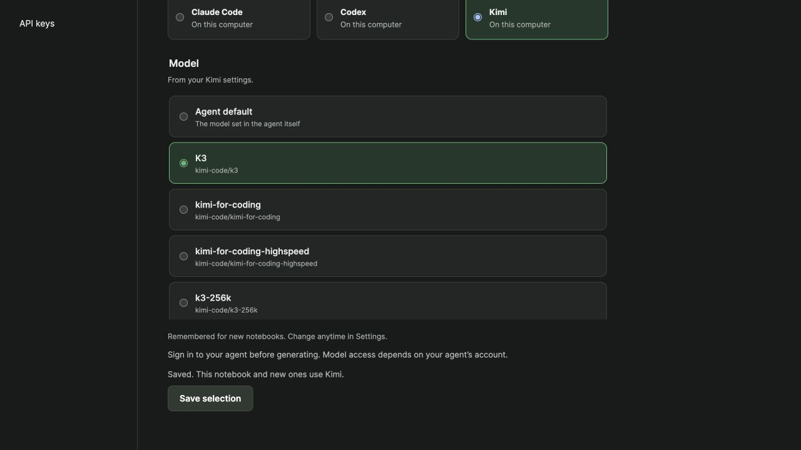

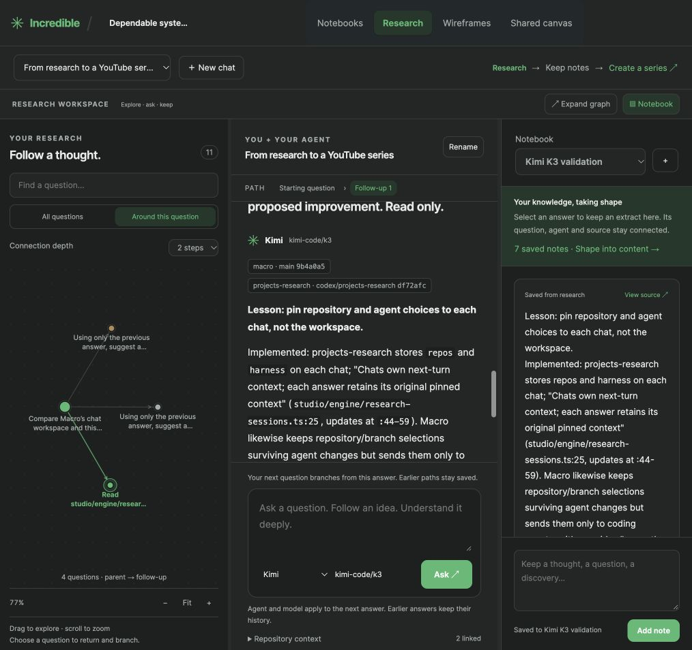

### K3 test finding: unchanged agent picker cannot close with Done

**Severity: P2 · reproducible · not fixed in this testing pass.** While K3 is generating wireframes, open the agent picker, leave Kimi and K3 unchanged, and click **Done**. The picker remains open with “Wait for the current generation to finish before changing agents.” Escape does dismiss it, and generation continues.

Expected: Done should dismiss an unchanged selection. Actual: `studio/app/agent-menu.ts` always submits settings, and `setNotebookHarness` in `studio/engine/notebook-intake.ts` rejects any submission while generation is active. This makes a harmless inspection look like a failed agent change.

Screenshot annotations: **1 — Kimi/K3 remain selected; no change was made. 2 — Done produces the generation-lock error instead of closing.** See the [annotated evidence](projects-research-evidence/kimi-k3-agent-picker-annotated.html).

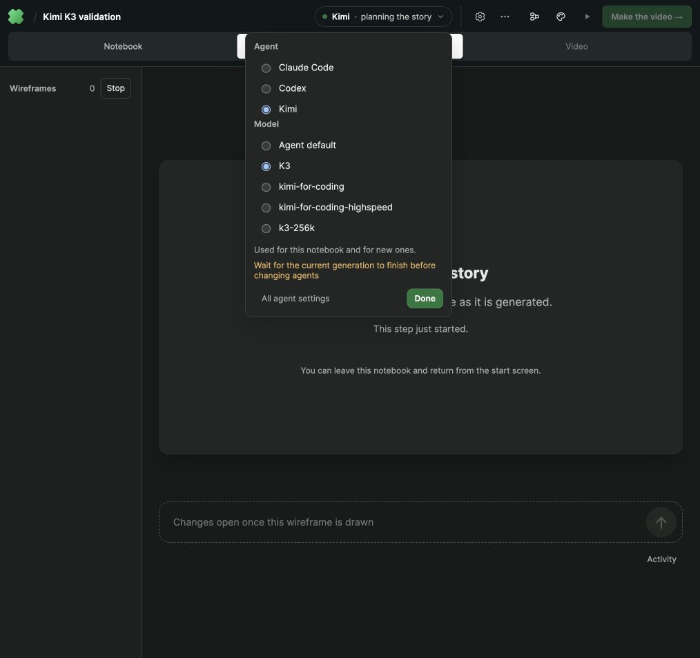

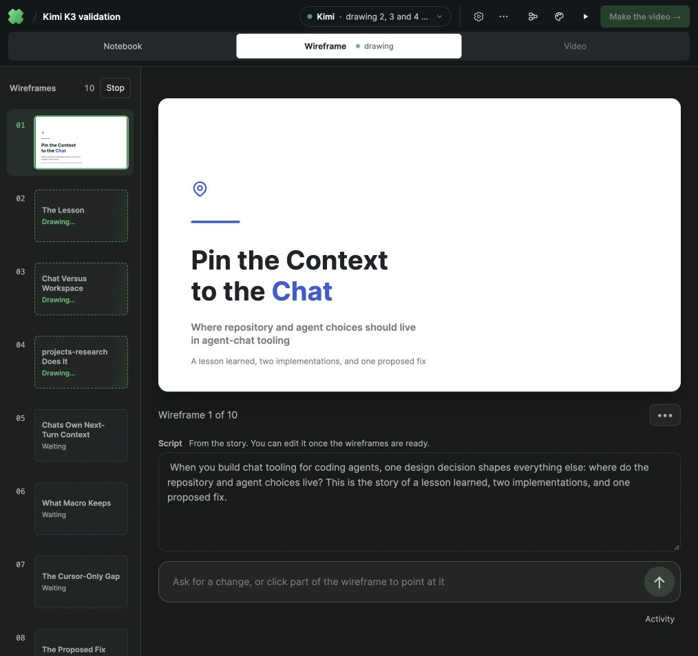

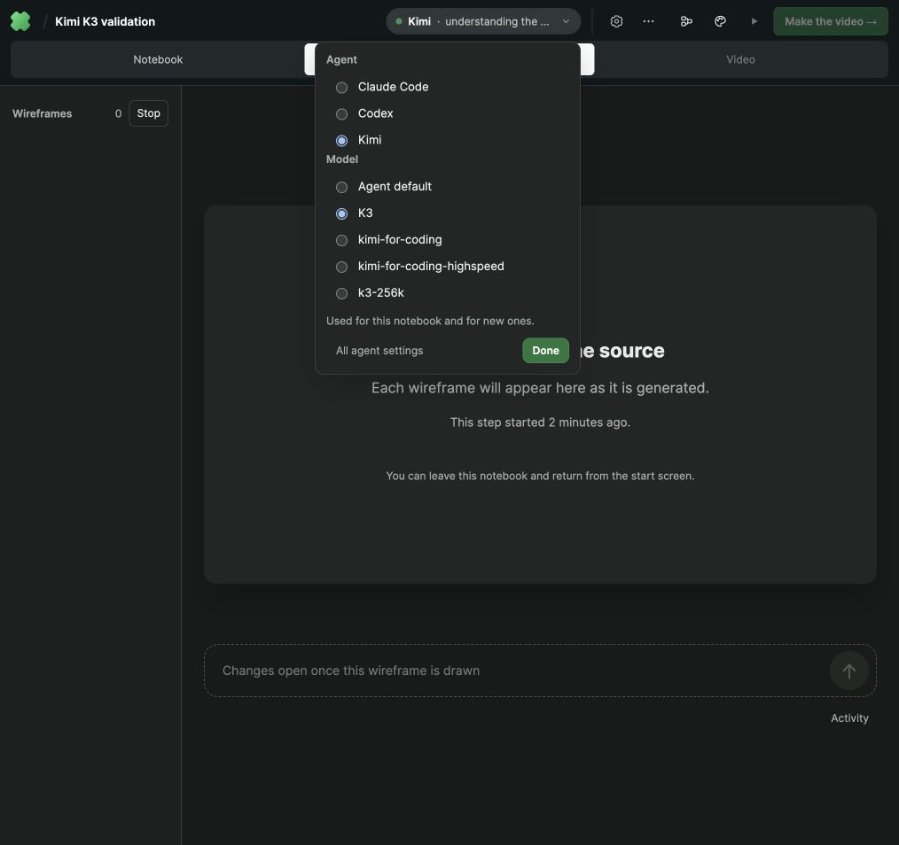

This pass changed test settings and added review evidence only. No application source was modified. The earlier automated suite/build results above remain the latest code checks; `git diff --check` passes for this documentation update.

## Conversation-first UX cleanup

The research view now starts with the conversation. Graph and Notebook are explicit toggles in one chat bar; agent/model and repository settings sit beside the composer. Opening a saved excerpt reveals its notebook automatically. Secondary source receipts and graph controls expand on demand. Notes read as document blocks with thin separators, while source links and branching remain available.

The project header, chat bar, reading width, composer and notebook styles have been simplified together. On compact screens only one supporting pane opens at a time; on phones selecting a graph question or a note's source returns to the conversation. Pane changes and resizing retain unsent drafts. The original Incredible SVG logo is reused on the landing page, project header and research surfaces. The temporary asterisk branding has been removed. Selected project tabs remain legible on hover in dark mode.

### Macro and Notion comparison

Macro's current local frontend runs at `http://localhost:3004` against the existing local `tour` backend on port 27509. Its supported passwordless development flow successfully signed into the seeded Alice persona. No password, hosted account or new auth bypass was required. The relevant implementation is in Macro's `apps/web/src/features/auth/EmailForm.tsx` and `Login.tsx`; `docs/AGENT_GUIDE/login.md` documents the flow.

The visible review exercised Home, its persistent navigation, a document, its contextual side panel, **Ask Macro**, and the resulting adjacent chat with the document already attached. Opening an existing chat preserved the document pane. The useful patterns are a stable resource location, a compact composer, contextual actions and independent panes. Macro's split-router documentation separately confirms stable component identity and per-pane navigation/history. Notion's [sidebar guidance](https://www.notion.com/help/navigate-with-the-sidebar) informed keeping organization available without displaying every secondary action at once.

Limit: this restored Macro backend has older service artifacts. The document body remained in initial-sync loading, and its agent harness was restarting with missing integration configuration. The document-to-chat attachment and split were verified, but no live AI answer or successful document editing is claimed for Macro. Its source files were not changed.

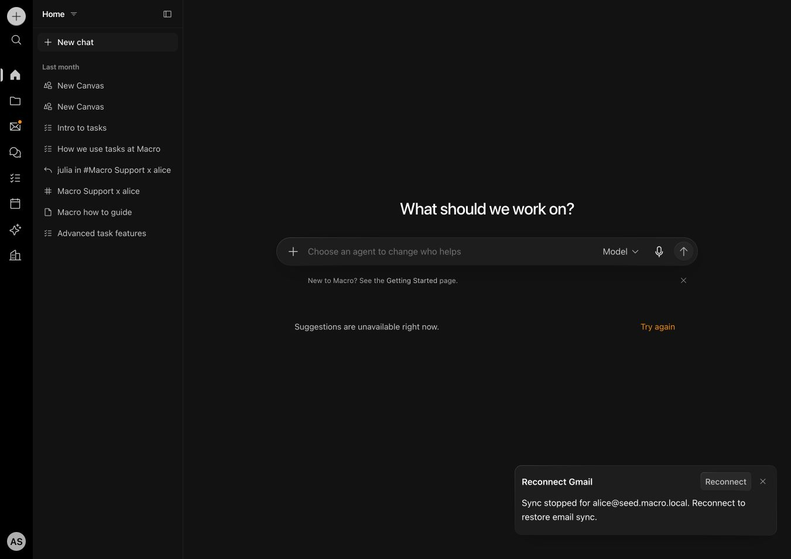

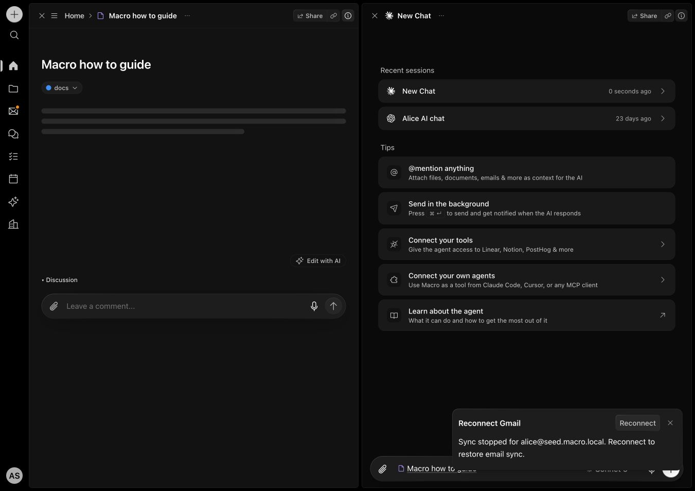

### Validation and evidence

- Visible browser checks on 4291/4391 covered conversation, graph, notebook, source navigation, model/repository popovers, draft retention, pane resizing, the continuous wireframe jump selector and the shared canvas handoff.
- A real follow-up completed with Kimi `kimi-code/k3` (question `7d8c1eeb-c5d8-4899-9221-30b6e1989f61`). Engine records confirmed both requested and reported model IDs and successful completion. Saving its answer preserved the source and opened **Kimi K3 validation** beside the conversation.
- The previously started K3 notebook now displays all ten generated wireframes. The shared canvas lists all four notebooks and thirteen connected wireframes. No finished video or YouTube upload is claimed.
- At 390 × 844, the document width is exactly 390px and the composer ends at 832px. Graph and notebook navigation were also exercised at mobile width. Temporary viewport overrides were reset.
- After the final code changes: 5 focused test files / 28 tests passed; TypeScript and the production build passed; formatting, source-size and whitespace checks passed. The existing bundle-size warning remains. This pass does not claim a new full-suite or storage run; it changes presentation and workspace interaction only.

See the [annotated cleanup evidence](projects-research-evidence/ux-cleanup-annotated.html). The earlier unchanged-agent-picker finding remains open; it is outside this research workspace cleanup.

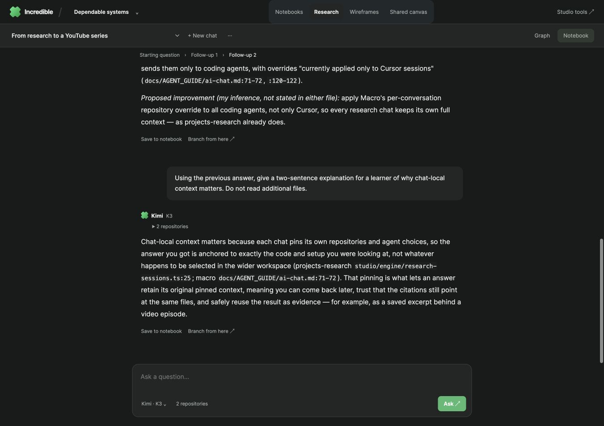

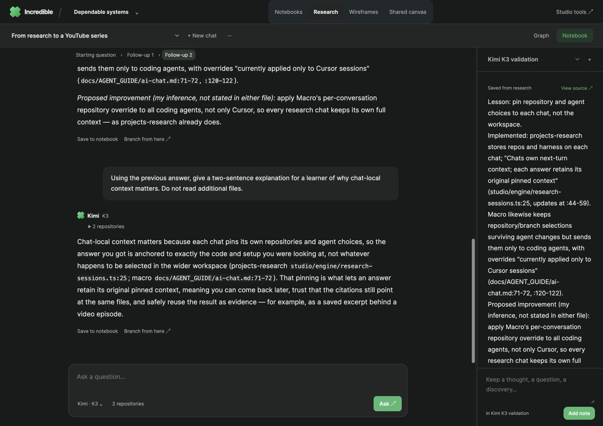

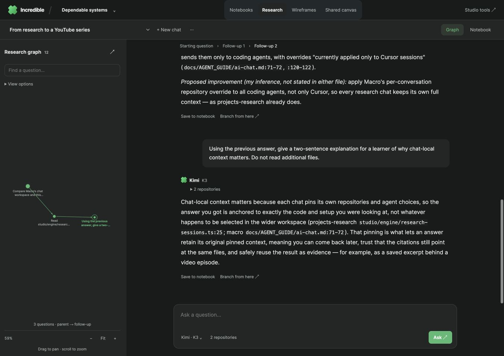

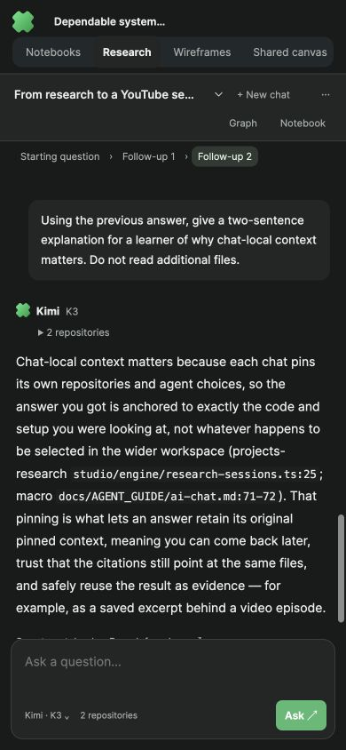

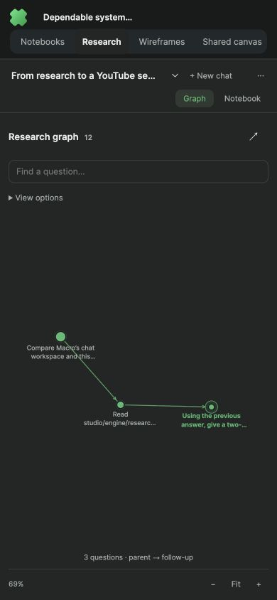

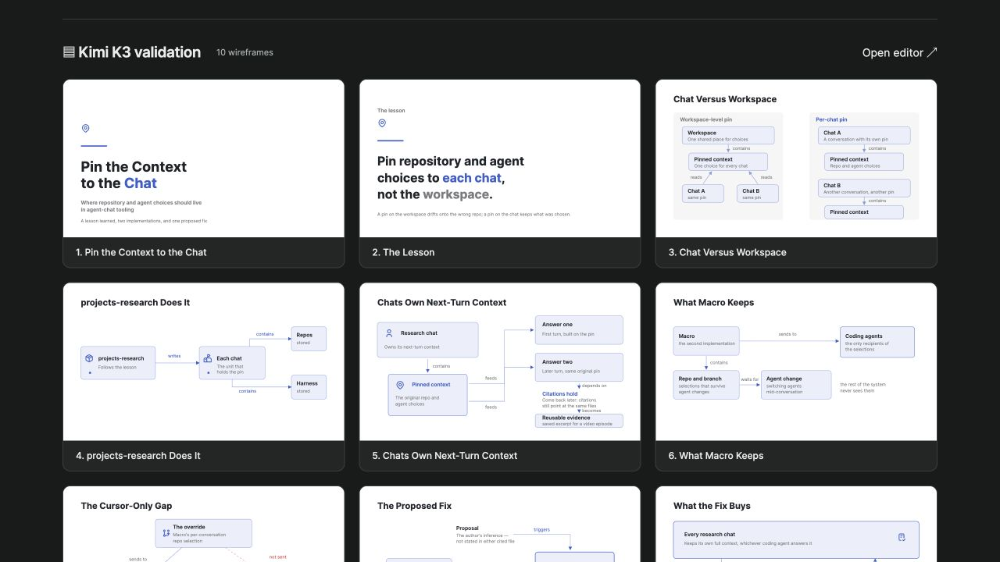

## Connected project workspace: chats, documents, and visual content

This iteration supersedes the top-level Research / Notebooks / Wireframes / Canvas navigation in the previous screenshots. A persistent project sidebar now contains chats, notebooks, and Content. The original Incredible logo remains unchanged. Chat, notebook, and visual content are views of the same project data.

The reference patterns have distinct jobs:

- **Macro:** the locally reviewed chat-and-document workspace informs the stable sidebar, adjacent notebook pane, and one context setup flow. Creating a chat now chooses the project, destination notebook, agent/model, and up to four local repository/branch pairs. New projects and notebooks can be created inside that flow. Chat details edits those same choices later.
- **Notion:** [sidebar organization](https://www.notion.com/help/navigate-with-the-sidebar) informs the project/notebook hierarchy and collapsible notebook list. A notebook expands into a focused document reading surface and returns beside the chat. Existing note capture and source provenance remain intact.
- **Obsidian:** [Graph view](https://obsidian.md/help/plugins/graph) informs question ancestry, local graph exploration, and navigation through related research. Notes now show **Questions from this note** links; answers show the notebooks in which they were saved. These links use actual source and anchor IDs.
- **Flora:** [Canvas concepts](https://docs.flora.ai/editor/canvas) inform a visual sequence of connected research, notebook content, and generated wireframes. Each notebook has a row in a continuous overview, with a jump selector and expandable wireframe previews. One project canvas aggregates all notebooks and leads to series creation. This is a view of real content and provenance; it does not introduce Flora's generic model-workflow execution system.

### Visible-browser validation on the parallel stack

The frontend remained on **4291** and the backend on **4391**, using disposable data in `/private/tmp/incredible-projects-research`. Port 4187 was not used.

1. Cancelled a new-project setup without creating a project. Then created **Learning in connected notebooks** in **Dependable systems**, creating **Connected learning** as its notebook. Selected Kimi `kimi-code/k3`, projects-research on `codex/projects-research`, and Macro on `main` in the same dialog.
2. Ran a real two-repository question (`11217bf9-8add-450d-944b-277f2e4d70c2`) and saved its answer. Asked a follow-up from that saved note (`89de1a00-355a-4c9b-9ca3-b425d57cf8c8`). Both engine runs completed and reported `kimi-code/k3`.
3. Followed the notebook's new question link to its answer, opened the graph, and clicked the parent node to backtrack. Selected a 72-character passage from the follow-up in the browser and saved only that excerpt with its source.
4. Switched chats with an unsent draft, then returned. The draft, notebook, K3 selection, and both repositories were restored. Chat details also retained the choices after editing the agent selection and saving. Historical answers kept their original context.
5. Generated all **ten planned wireframes** directly from Content using the selected K3 harness, then opened the completed editor (Wireframe 1 of 10, with Make the video available). Engine records confirmed `kimi-code/k3`. The shared project canvas automatically incorporated the new research as a fourteenth card, **Resumable Research Sessions**. The canvas's Back to project link returned to Content.
6. At **390 × 844**, verified chat, navigation drawer, notebook capture, and Content with no horizontal overflow (document width 390px). Created **Workspace onboarding check**, **First thoughts**, and **First exploration** through the mobile setup dialog, then saved a note. A header overlap found in this test was fixed and rechecked. Temporary viewport overrides were reset.

### Checks and boundaries

The complete regression suite passed with two workers: **231 files / 1,519 tests**. The unrestricted default parallel run hit an existing five-second timeout in `review-8-portrait-2.test.ts`; that test passed separately and in the bounded full run. The first sandboxed run could not start several temporary local servers, so its failures are not counted as passing checks. PostgreSQL/MinIO disposable storage checks passed. Production build, focused research checks, formatting, source-size limits, and whitespace checks passed; the existing large-bundle warning remains.

The earlier unchanged-agent-picker finding in the legacy wireframe editor remains open. The old shared-canvas note with an interrupted sort still offers Sort again; this was not introduced by this workspace change. No completed video or YouTube upload is claimed. Macro's document-sync limitation described above is unchanged.

See the [annotated connected-workspace evidence](projects-research-evidence/connected-workspace-annotated.html).

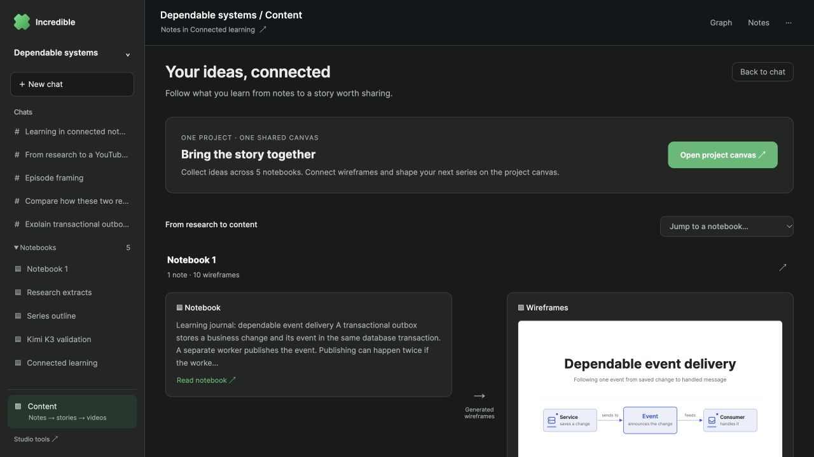

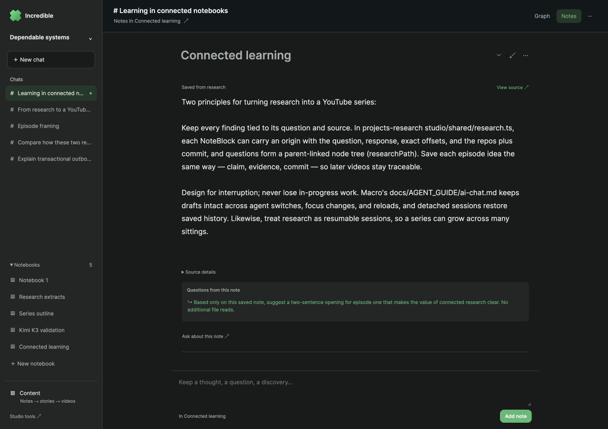

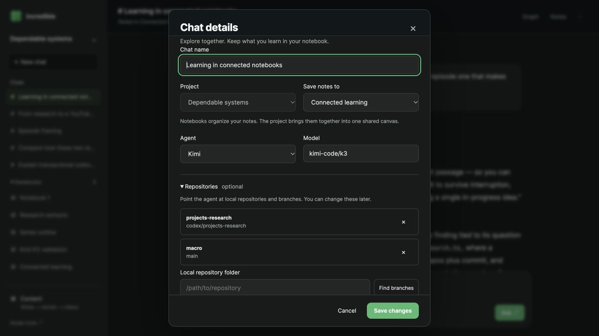

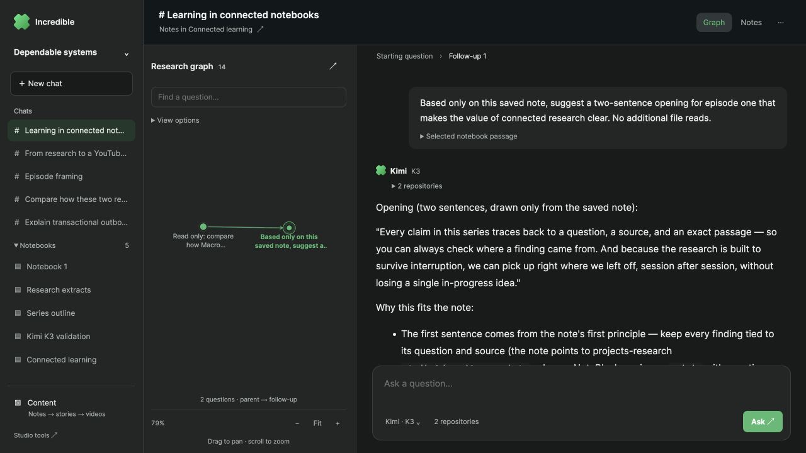

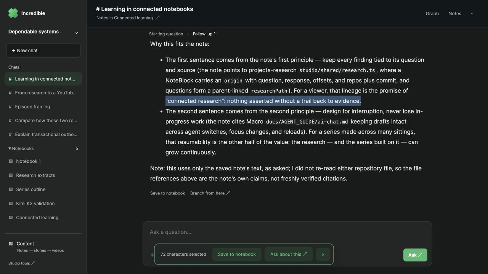

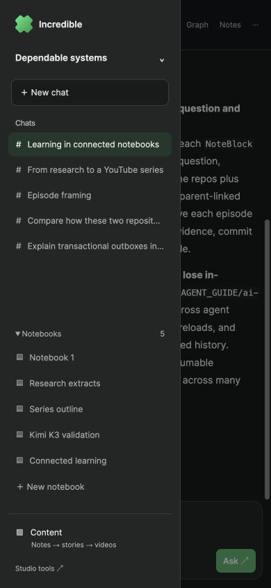

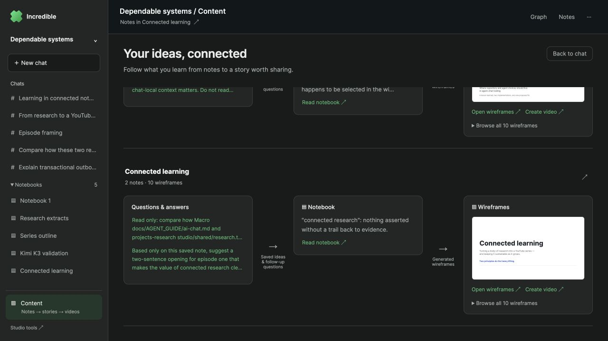

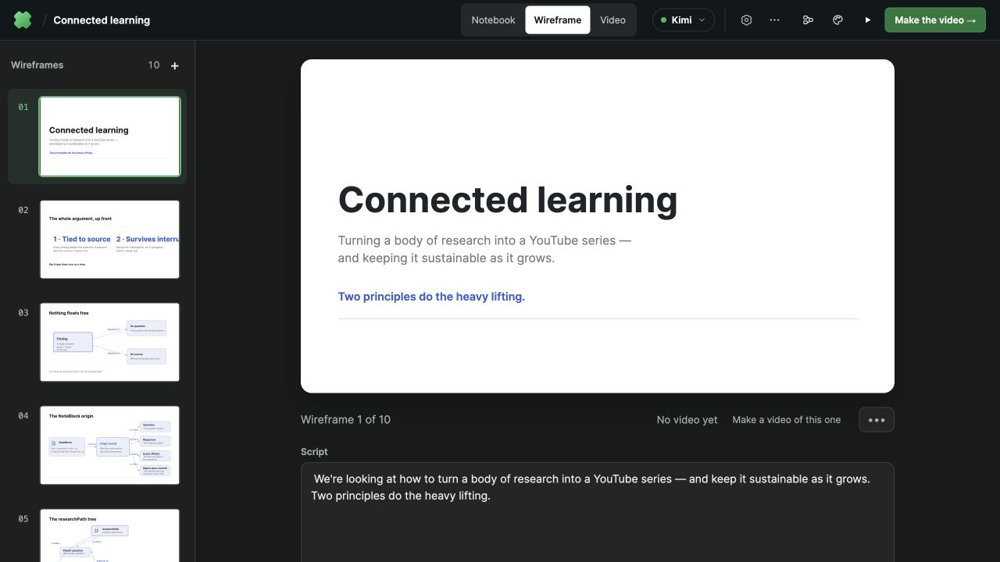

## One coherent project workspace

The content-to-editor handoff previously discarded project navigation. A generated
notebook also exposed a second, read-only “Notebook” page, and the wireframe Map
button opened that notebook's individual map rather than the shared project map.
These paths now use the same project shell, sidebar and contextual navigation.
The original Incredible logo is retained.

- Chat, notebook, wireframe and canvas links carry the project, notebook, chat and
  selected question. Internal handoffs keep the controller roots mounted.
- Notes have one destination: the project's notebook. Historical engine source
  links resolve to the notebook, or all project content for the aggregated source.
- Notebook reading exposes its generated wireframes directly. Project sidebar
  notebook selection opens a focused document, while saved-answer links can keep
  the notebook beside the conversation.
- The Map action opens the shared project canvas. Wireframes and video remain
  inside project navigation. New chat from the output sidebar opens the existing
  project/notebook/repository/agent setup flow.
- Returning to research preserves the unsent draft and exact reading position.
  Navigation stops obsolete subscriptions and ignores late notebook/project loads.
  Active recordings cannot be abandoned by a project-navigation click.
- At phone width, Back to chat reveals the conversation instead of leaving the
  notebook over it. The drawer works from the output editor, and the video action
  is readable without horizontal page overflow.

### Visible-browser proof

[Annotated screenshots](projects-research-evidence/coherent-workspace-annotated.html)
show the actual UI on the parallel 4291/4391 stack. The 4187 stack was not used.

1. Opened the exact aggregated-source URL from the user's report; it resolved to
   the project content view instead of a disconnected notebook reader.
2. Clicked notebook → wireframes → project canvas → Back to chat. The shared
   canvas had the existing 14 generated cards from all five notebooks.
3. Typed an unsent test question, scrolled the transcript, opened wireframes and
   returned. The draft was unchanged, and scrollTop was **787 px before and
   after**. The temporary draft was cleared after verification.
4. Opened the video stage and its Make the video dialog; scene, voice, template
   and length choices loaded. No new video generation was submitted.
5. At **390 × 844**, opened the editor drawer and New chat setup, cancelled, and
   tested notebook → wireframes → Back to chat. The composer became visible;
   document width equalled viewport width (390 px). Reset the viewport afterward.

The screenshots use the existing real **kimi-code/k3** research and ten generated
Connected learning wireframes from the preceding validation. This pass did not
claim new AI generation, a finished video, channel publishing, or multiplayer
collaboration.

### Validation for this change

- `yarn test --maxWorkers=2`: **232 files / 1,528 tests passed**. The first full
  run caught a changed legacy stage label; the standalone label was restored,
  and the final complete run passed.
- `yarn build`: passed (TypeScript and Vite). The existing bundle-size advisory
  remains; it is not a build failure.
- Formatting, 800-line/500-character source limits and `git diff --check`: passed.
- New regression coverage exercises context links, canonical notebook routing,
  persistent controller roots, late-load cancellation, active-recording protection,
  mobile return to chat and branch-specific reading position.
- Storage code and schemas are unchanged in this pass; the preceding storage
  validation remains documented above.

This change is committed locally on `codex/projects-research`, with Karthic Rao
`<kartronics85@gmail.com>` as author and committer. It has not been pushed.
