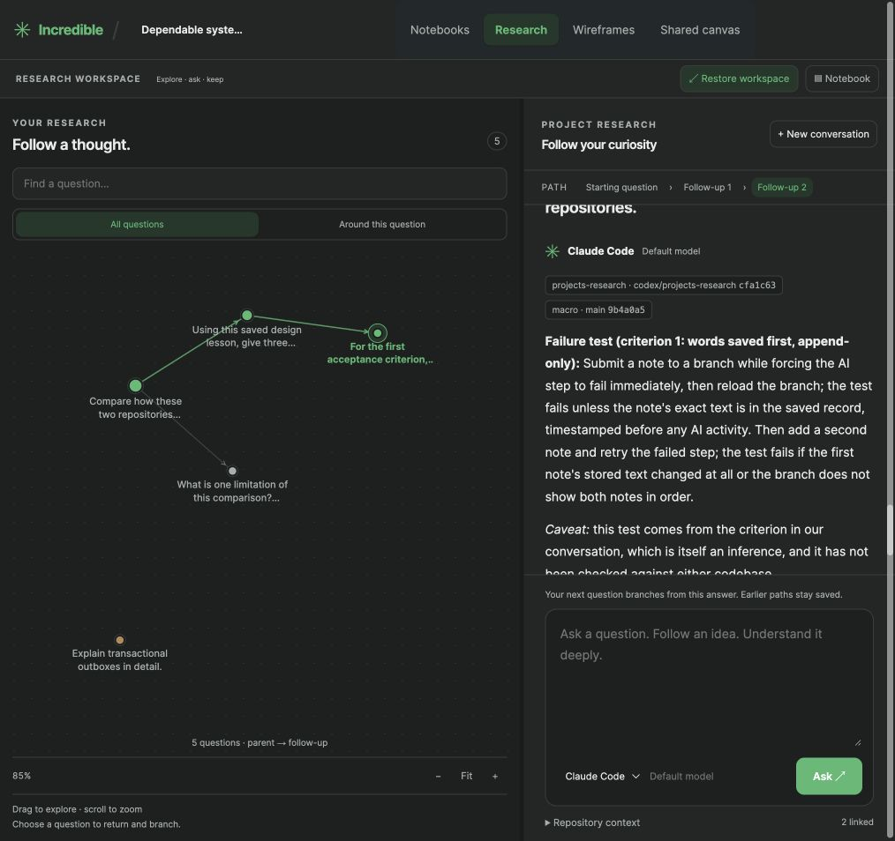
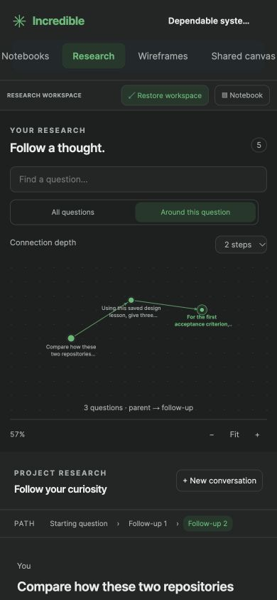

# Spatial question graph and research workspace

## Reference research

Reviewed the official [Obsidian Graph view documentation](https://obsidian.md/help/plugins/graph) and [workspace overview](https://obsidian.md/help/workspace). Adopted node/link navigation, connection highlighting, pan/zoom, and a local graph with bounded depth. Arrows indicate actual parent-to-follow-up relationships; proximity does not imply another relationship.

Reviewed these local Macro references:

- `apps/web/src/lib/split-router/README.md`: navigation separate from pane layout and content lifecycles.
- `apps/web/src/components/app/split-layout/SplitLayout.tsx`: stable pane identity and resizable composition.
- `docs/FRONTEND_FEATURE_ARCHITECTURE.md`: pure transformations, presentation, state behavior and host integration as separate responsibilities.
- `docs/AGENT_GUIDE/ai-chat.md`: context changes preserve the composer and draft.

These patterns are adapted to Incredible's existing architecture.

## Implemented

- Spatial graph with deterministic spring layout, directional edges, degree-sized nodes, selected ancestry, and immediate-neighbor hover/focus highlighting.
- All questions or Around this question, with one to three connection steps.
- Drag to pan, scroll to zoom, Fit, keyboard arrows, +/- and 0.
- Search highlights matches and reports the count.
- Clickable ancestry trail; graph navigation scrolls to the selected turn.
- Resizable graph/chat/notebook panes, notebook visibility and expanded graph mode.
- Per-project layout preferences survive reload.
- Question drafts belong to their branch; note drafts belong to their notebook.
- Composer elements retain DOM identity across layout and agent-control changes for the same resource.
- Graph framing responds to viewport size, local depth and new questions.

## Architecture

`research-graph-model.ts` owns layout and neighborhood calculations; `research-graph.ts` renders them. `research-graph-viewport.ts` owns the camera and pointer/keyboard behavior. `research-layout.ts` defines normalized pane preferences and draft identities. `research-workbench.ts` owns pane sizing and persistence. `research-workbench-view.ts` composes controls, graph and ancestry. `research-render.ts` retains composer elements. The existing host owns project loading, requests and navigation.

## Validation

Tested visibly on frontend 4291 / engine 4391 with disposable data. Completed a real Claude Code follow-up, producing a three-level path alongside a sibling branch. Checked local depth, expansion, panning, fit, keyboard resizing, reload, branch and notebook draft isolation, and a 390px viewport. Corrected mobile framing and selected-turn navigation found during these checks.

Automated coverage includes bounded neighborhoods, actual edge identity, deterministic coordinates, malformed/cyclic graph tolerance, normalized preferences, draft key isolation and composer identity. Existing lineage, cancellation and shared-canvas checks continue to pass. Final result: 229 test files / 1,499 tests passed; production build, formatting, source-size and diff-whitespace checks passed. No browser console errors were observed.

The graph represents question lineage, not inferred semantic connections. Above 180 questions, it uses hierarchy coordinates to bound layout work. Workspace panes remain graph, conversation and notebook; arbitrary document tabs and Macro's full router are outside this change.
